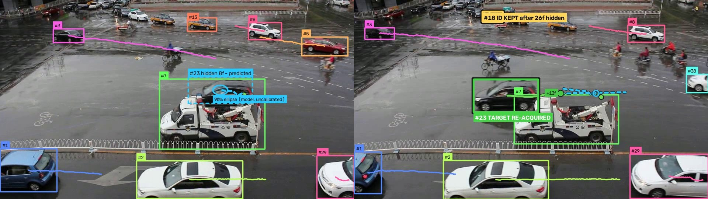

# GapLink-Lite: Vehicle Identity Re-Association Across Occlusions

GapLink-Lite is a small, self-developed neural network (**327,979 parameters**, trained from random initialisation) that decides whether a vehicle re-appearing after an occlusion is the same vehicle the tracker lost, a different one, or nobody yet. It combines a GRU motion encoder, a calibrated Gaussian prediction of where the vehicle should re-appear, and a Sinkhorn assignment with learnable *dustbins* for "the vehicle has left" and "this is a new vehicle".

**GapLink Live** is the demonstration console: upload a traffic video, and the full pipeline (YOLOv8n → IoU matching → GapLink-Lite) runs on it on the spot, with identity recovery, target lock and forbidden-route alerts drawn over the video for visual inspection.

Capstone project, Samsung Innovation Campus (SIC) – AI Course.



## Results

All results come from locked test runs on UA-DETRAC: thresholds were selected on validation, and the test split was evaluated once from frozen checkpoints. 95% confidence intervals are paired bootstraps over the 15 test camera locations.

**Phase 1: ground-truth boxes, controlled occlusions (3–90 frames)**

| Method | Event Top-1 | Event wrong links | Tracker IRR | Tracker wrong links | IDF1 |
|---|---:|---:|---:|---:|---:|
| C-2 Constant velocity | – | – | 85.17% | 4.32% | – |
| C-3 Kalman + Mahalanobis | 80.29% | 19.24% | 84.96% | 10.25% | 77.60% |
| C-4 Kalman + size + colour | 83.69% | 15.88% | – | – | – |
| **GapLink-Lite** | **93.41%** | **3.01%** | **96.20%** | **0.21%** | **99.11%** |

- Event Top-1 gain over C-3: +13.12 pp (CI [12.29, 14.19]). On long gaps (46–90 frames), Top-1 rises from 64.24% (C-4) to 79.58%.
- Pre-registered hypotheses:
  - H1: supported.
  - H2: **not supported**. Calibrated 90% coverage for long gaps reached 95.14% on validation, above the 95% bound.
  - H3: supported in 3 of 3 gap bins.
  - P1: passed.

**Phase 2: live YOLOv8n detector, natural occlusions (40 test videos)**

| Method | Nat-IRR | Nat-WLR | Route false-alarm rate |
|---|---:|---:|---:|
| C-2 Constant velocity | 84.58% | 12.92% | 11.32% |
| C-3 Kalman + Mahalanobis | 57.63% | 24.70% | 32.56% |
| C-4 Kalman + size + colour | 61.85% | 9.94% | – |
| **GapLink-Lite v1.3** | **84.41%** | **6.09%** | **9.27%** |

- Against C-2, recovery is equal (Δ −0.17 pp, CI [−1.33, 1.08]) and **wrong links are halved** (Δ −6.82 pp, CI [−11.04, −3.18]).
- The trade-off is route recall: GapLink-Lite catches 42.59% of occluded forbidden-route crossings, against 47.53% for C-3.
- No method stays below the 5% live wrong-link target on test.

**Speed:**
- GapLink-Lite runs in 8–9.5 ms per frame on one CPU thread.
- End to end (YOLOv8n + two trackers side by side, as measured for the report) the pipeline ran at 36–46 FPS on an RTX 3050 Laptop GPU (6 GB).

The full analysis, including limitations and the evaluation history, is in the report: [`report/latex/main.pdf`](report/latex/main.pdf) (English) and [`report/latex/main_vi.pdf`](report/latex/main_vi.pdf) (Vietnamese).

## How it works

```
video ─► YOLOv8n boxes + HSV histograms
       ─► Stage 1: IoU + Hungarian matching of active tracks
       ─► Stage 2: lost tracks × unmatched detections ─► GapLink-Lite
              GRU motion encoder ─┐
              DeepSets context ───┼─► Gaussian prediction ─► pairwise + dustbin scores ─► log-Sinkhorn
              gap embedding ──────┘                                                         │
       ◄── re-link (P ≥ τ and P > dustbin) or keep waiting ◄────────────────────────────────┘
       ─► surveillance rules (forbidden route, target lock) ─► console
```

- **Training data.** The model is trained on occlusion events sampled from UA-DETRAC ground-truth trajectories, with box noise, partial occlusion and a curriculum of hard events.
- **Fine-tuning for the live detector.** For the live setting, it is fine-tuned on events produced by YOLOv8n on the training videos (checkpoint v1.3).
- **Data split.** The data is split by camera location: 25 clusters, with no location shared between training and validation.

## Repository structure

```
configs/         training, ablation and tracker configs; paths.yaml (all paths)
src/             data I/O, event sampling, GapLink-Lite model, baselines C-1…C-4,
                 online tracker, metrics, calibration, live evaluation, surveillance rules
  model/         motion encoder, context encoder, Gaussian predictor, scorer, Sinkhorn
train.py         training entry point
scripts/         data conversion, evaluation, freezing, figures, video preparation, demo clip export/check
  pipelines/     PowerShell pipelines used for the live (v1.2/v1.3) and extra runs
demo/            GapLink Live console (gaplink_live*.py) and its tracking/drawing core
  showcase/      the 5 raw demo videos (UA-DETRAC test frames) and SOURCES.json (origin, SHA-256)
  uploads/       videos uploaded in the console (git-ignored)
release/         frozen checkpoints, thresholds, calibration and result files (SHA-256 pinned)
docs/            pre-registrations (PREREG*.md) and deviation log (DEVIATIONS.md)
report/latex/    SIC capstone report (LaTeX source, English and Vietnamese PDFs)
tests/           pytest suite (CPU only)
```

## Installation

Tested on Windows 11, Python 3.12, PyTorch 2.11 (CUDA 12.8), RTX 3050 Laptop 6 GB.

Run every command from the project root (the folder that contains `README.md`); the project can be unpacked anywhere.

```powershell
python -m venv .venv
.venv\Scripts\pip install torch --index-url https://download.pytorch.org/whl/cu128
.venv\Scripts\pip install -r requirements.txt
.venv\Scripts\python -m pytest -q
```

- **Paths.** Scripts locate the project root from their own file location; `configs/paths.yaml` holds paths relative to it.
  An absolute `root_dir` can be set there to keep the data elsewhere.
- **Detector weights.** `release/yolov8n.pt` (Ultralytics YOLOv8n, SHA-256 pinned in `release/FREEZE_MANIFEST.json`) is
  needed by the demo and the live evaluation. It is shipped with the submitted source; if it is missing, download
  `yolov8n.pt` from the Ultralytics releases into `release/`.
- **Tests without data.** Four tests need the converted UA-DETRAC data or the cached event sets and are skipped until
  the data steps below have been run; all other tests run on the CPU without data.
- **Frozen results.** `release/results_v1.1/` and `release/results_v1.3/` are byte-identical copies of the result files
  listed in the freeze manifests (same SHA-256). `scripts.freeze_results` checks the originals under `runs/` and
  `data/cache/`, so it reports them as missing until the pipeline has been re-run.

## Running the demo

```powershell
.venv\Scripts\python -m demo.gaplink_live --fresh    # open http://127.0.0.1:8001
```

`--fresh` starts with an empty video list; without it, videos processed earlier are listed again.

On Windows, double-clicking **`run_demo.bat`** does the same: on the first run it creates `.venv` and installs
`requirements.txt` (needs Python 3.12 and internet; PyTorch from PyPI is the CPU build, which is enough for the demo),
then it starts the console and opens the browser. The demo videos are in `demo/showcase/`.

**Workflow.**
1. Drag a video onto the page (or use *Upload video*). The file is stored in `demo/uploads/` and its SHA-256 is shown.
2. The server resamples it to 25 fps, resizes it to 960 px wide and runs YOLOv8n once, with the same settings as the
   evaluation (`scripts/prepare_video.py`). A progress bar follows the detection pass.
3. The video plays with GapLink-Lite as Stage 2. Nothing is pre-rendered: every overlay is drawn while it plays, and
   no ground truth is used, so the viewer checks the identities by eye.

**What is drawn.**

| Overlay | Meaning |
|---|---|
| Coloured box `#k` | one colour per track ID |
| Dashed box `#k hidden` | a vehicle lost inside the image, at the place it was last seen |
| `#k ID KEPT after N f hidden` + dashed bridge | Stage 2 gave the vehicle its old ID back after N frames |
| Locked target (click) | full path: solid where seen, dashed where GapLink predicts it while hidden; optional 90% ellipse |
| Z_A / Z_B and `FORBIDDEN ROUTE` | forbidden-route mode: zones drawn on the video, alert when a vehicle goes from Z_A into Z_B |

The ellipse uses the σ predicted by the v1.3 model, which is not calibrated (illustration only).

**Keys.** Space play/pause · ← → one frame · **O** hide/show every overlay (the untouched video) · U unlock ·
I IDs · T trails · E ellipse · Enter/Esc finish/cancel a zone.

**Demo videos** (`demo/showcase/`, origin and SHA-256 in `SOURCES.json`):

| File | UA-DETRAC test sequence | Frames | Scene |
|---|---|---|---|
| `demo1.mp4` | MVI_40901 | 170–325 | rainy intersection, a car passes behind a tow truck |
| `demo2.mp4` | MVI_40743 | 1365–1495 | night avenue, overtaking |
| `demo3.mp4` | MVI_40763 | 155–275 | night, a van hidden behind a bus |
| `demo4.mp4` | MVI_40864 | 410–565 | a minivan hidden behind a red bus |
| `demo5.mp4` | MVI_40855 | 952–1090 | intersection, three vehicles crossing in front of each other |

They are raw frames from test sequences the model never saw in training, chosen to *illustrate* occlusion
recovery: each was checked against the ground truth through the same path as an upload (`scripts/demo_audit.py`:
one-to-one matching, part-of-vehicle boxes, every ID change). They are **not** a measurement; the frozen tables above
are.

```powershell
.venv\Scripts\python -m scripts.check_showcase demo\showcase\demo1.mp4                    # re-check a clip
.venv\Scripts\python -m scripts.export_showcase --seq MVI_40901 --f0 170 --f1 325 --name demo1   # re-cut it from data/
```

## Reproducing the results

The scripts below follow the order in which the results were produced. Data goes to `data/` and outputs to `runs/`; both are git-ignored.

```powershell
# data
.venv\Scripts\python -m scripts.fetch_data          # download and extract UA-DETRAC
.venv\Scripts\python -m scripts.convert_detrac      # MOT format, ignore-region cleaning
.venv\Scripts\python -m scripts.group_locations     # 25 camera clusters, location-disjoint split
.venv\Scripts\python -m scripts.extract_hist        # 128-bin HSV histograms
.venv\Scripts\python -m scripts.make_fixed_events   # fixed validation/test event sets
.venv\Scripts\python -m scripts.gen_pool            # training event pool

# Phase 1
.venv\Scripts\python train.py --config configs/main.yaml
.venv\Scripts\python -m scripts.calibrate_and_freeze
.venv\Scripts\python -m scripts.run_test --ckpt release/final.pt
.venv\Scripts\python -m scripts.freeze_results --set v1.1   # verify hashes of frozen results

# Phase 2 (detector-aware fine-tuning, validation selection, single test run)
powershell -ExecutionPolicy Bypass -File scripts\pipelines\run_v13_pipeline.ps1
.venv\Scripts\python -m scripts.freeze_results --set v1.3
```

`docs/PREREG.md` and `docs/PREREG_live_v1.3.md` contain the hypotheses and selection rules that were fixed before the test runs. `docs/DEVIATIONS.md` lists every deviation, including:
- a second Phase-1 test run after a data-conversion fix;
- a validation-only variant that was abandoned.

## Data and licence notes

- UA-DETRAC is a public research benchmark; its terms of use apply to the data and to clips cut from it.
- YOLOv8n (Ultralytics) is used unchanged as the live detector only. The GapLink-Lite model uses no pretrained weights.
- The system processes vehicle boxes and colour histograms only. It does not read licence plates or recognise people.
