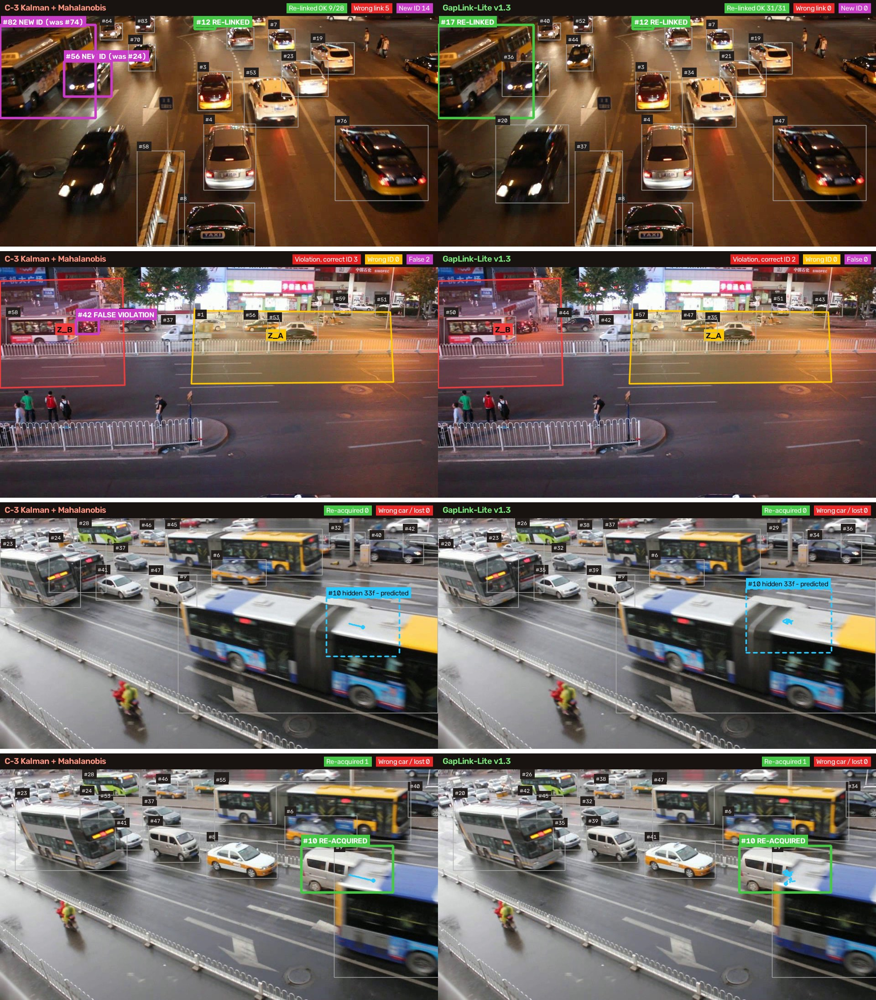

# GapLink-Lite: Vehicle Identity Re-Association Across Occlusions

GapLink-Lite is a small, self-developed neural network (**327,979 parameters**, trained from random initialisation) that decides whether a vehicle re-appearing after an occlusion is the same vehicle the tracker lost, a different one, or nobody yet. It combines a GRU motion encoder, a calibrated Gaussian prediction of where the vehicle should re-appear, and a Sinkhorn assignment with learnable *dustbins* for "the vehicle has left" and "this is a new vehicle".

**GapLink-VMS** is a lean demonstration console that runs a Kalman-filter tracker (C-3) and GapLink-Lite side by side on the same YOLOv8n detections, on three surveillance tasks: identity recovery, forbidden routes and following a locked target.

Capstone project, Samsung Innovation Campus (SIC) – AI Course.



## Results

All results come from locked test runs on UA-DETRAC: thresholds were selected on validation, and the test split was evaluated once from frozen checkpoints. 95% confidence intervals are paired bootstraps over the 15 test camera locations.

**Phase 1: ground-truth boxes, controlled occlusions (3–90 frames)**

| Method | Event Top-1 | Event wrong links | Tracker IRR | Tracker wrong links | IDF1 |
|---|---:|---:|---:|---:|---:|
| C-2 Constant velocity | – | – | 85.17% | 4.32% | – |
| C-3 Kalman + Mahalanobis | 80.29% | 19.24% | 84.96% | 10.25% | 77.60% |
| C-4 Kalman + size + colour | 83.69% | 15.88% | – | – | – |
| **GapLink-Lite** | **93.41%** | **3.01%** | **96.20%** | **0.21%** | **99.11%** |

- Event Top-1 gain over C-3: +13.12 pp (CI [12.29, 14.19]). On long gaps (46–90 frames), Top-1 rises from 64.24% (C-4) to 79.58%.
- Pre-registered hypotheses:
  - H1: supported.
  - H2: **not supported**. Calibrated 90% coverage for long gaps reached 95.14% on validation, above the 95% bound.
  - H3: supported in 3 of 3 gap bins.
  - P1: passed.

**Phase 2: live YOLOv8n detector, natural occlusions (40 test videos)**

| Method | Nat-IRR | Nat-WLR | Route false-alarm rate |
|---|---:|---:|---:|
| C-2 Constant velocity | 84.58% | 12.92% | 11.32% |
| C-3 Kalman + Mahalanobis | 57.63% | 24.70% | 32.56% |
| C-4 Kalman + size + colour | 61.85% | 9.94% | – |
| **GapLink-Lite v1.3** | **84.41%** | **6.09%** | **9.27%** |

- Against C-2, recovery is equal (Δ −0.17 pp, CI [−1.33, 1.08]) and **wrong links are halved** (Δ −6.82 pp, CI [−11.04, −3.18]).
- The trade-off is route recall: GapLink-Lite catches 42.59% of occluded forbidden-route crossings, against 47.53% for C-3.
- No method stays below the 5% live wrong-link target on test.

**Speed:**
- GapLink-Lite runs in 8–9.5 ms per frame on one CPU thread.
- The console runs at 36–46 FPS on an RTX 3050 Laptop GPU (6 GB).

The full analysis, including limitations and the evaluation history, is in the report: [`report/latex/main.pdf`](report/latex/main.pdf) (English) and [`report/latex/main_vi.pdf`](report/latex/main_vi.pdf) (Vietnamese).

## How it works

```
video ─► YOLOv8n boxes + HSV histograms
       ─► Stage 1: IoU + Hungarian matching of active tracks
       ─► Stage 2: lost tracks × unmatched detections ─► GapLink-Lite
              GRU motion encoder ─┐
              DeepSets context ───┼─► Gaussian prediction ─► pairwise + dustbin scores ─► log-Sinkhorn
              gap embedding ──────┘                                                         │
       ◄── re-link (P ≥ τ and P > dustbin) or keep waiting ◄────────────────────────────────┘
       ─► surveillance rules (forbidden route, target lock) ─► console
```

- **Training data.** The model is trained on occlusion events sampled from UA-DETRAC ground-truth trajectories, with box noise, partial occlusion and a curriculum of hard events.
- **Fine-tuning for the live detector.** For the live setting, it is fine-tuned on events produced by YOLOv8n on the training videos (checkpoint v1.3).
- **Data split.** The data is split by camera location: 25 clusters, with no location shared between training and validation.

## Repository structure

```
configs/         training, ablation and tracker configs; paths.yaml (all paths)
src/             data I/O, event sampling, GapLink-Lite model, baselines C-1…C-4,
                 online tracker, metrics, calibration, live evaluation, surveillance rules
  model/         motion encoder, context encoder, Gaussian predictor, scorer, Sinkhorn
train.py         training entry point
scripts/         data conversion, evaluation, freezing, figures, demo clip mining/export
  pipelines/     PowerShell pipelines used for the live (v1.2/v1.3) and extra runs
demo/            GapLink-VMS console (vms_lite.py) and its rendering/judging helpers
  sample_videos/ cached detections, ground truth and metadata of the 3 demo clips
release/         frozen checkpoints, thresholds, calibration and result files (SHA-256 pinned)
docs/            pre-registrations (PREREG*.md) and deviation log (DEVIATIONS.md)
report/latex/    SIC capstone report (LaTeX source, English and Vietnamese PDFs)
tests/           pytest suite (71 tests, CPU only)
```

## Installation

Tested on Windows 11, Python 3.12, PyTorch 2.11 (CUDA 12.8), RTX 3050 Laptop 6 GB.

```powershell
python -m venv .venv
.venv\Scripts\pip install torch --index-url https://download.pytorch.org/whl/cu128
.venv\Scripts\pip install -r requirements.txt
.venv\Scripts\python -m pytest -q
```

All data and output paths are read from `configs/paths.yaml`. Edit it if the project is not in `D:\gaplink`.

## Running the demo

```powershell
.venv\Scripts\python -m demo.vms_lite --port 8010   # dashboard at http://127.0.0.1:8010
.venv\Scripts\python -m demo.vms_lite --check       # recompute the counts of the 3 clips, no UI
.venv\Scripts\python -m demo.vms_lite --render      # side-by-side MP4s with slow motion (demo/out/)
```

`run_vms_lite.ps1` starts the dashboard and opens the browser.

**Clips.**
- `demo1_relink`: identity recovery.
- `demo2_route`: forbidden route. Zones can be redrawn and saved.
- `demo3_lock`: click a vehicle to lock it.

**Controls.**
- Space: play or pause.
- ← / →: step one frame.
- 1 / 2 / 3: switch clip.
- I: show or hide IDs.

**Video files.** The clip videos (`*.mp4`) are cut from UA-DETRAC test sequences and are not stored in the repository. The cached detections and ground truth are. To recreate the videos once UA-DETRAC is available locally:

```powershell
.venv\Scripts\python -m scripts.mine_demo3
.venv\Scripts\python -m scripts.export_demo_clip --scenario relink --rank 0 --name demo1_relink
.venv\Scripts\python -m scripts.export_demo_clip --scenario route  --rank 0 --name demo2_route
.venv\Scripts\python -m scripts.export_demo_clip --scenario lock   --rank 3 --name demo3_lock
```

The demo clips were selected on test videos to show the difference clearly. Their counts illustrate behaviour. They are not measurements; the frozen Phase-2 table above is.

## Reproducing the results

The scripts below follow the order in which the results were produced. Data goes to `data/` and outputs to `runs/`; both are git-ignored.

```powershell
# data
.venv\Scripts\python -m scripts.fetch_data          # download and extract UA-DETRAC
.venv\Scripts\python -m scripts.convert_detrac      # MOT format, ignore-region cleaning
.venv\Scripts\python -m scripts.group_locations     # 25 camera clusters, location-disjoint split
.venv\Scripts\python -m scripts.extract_hist        # 128-bin HSV histograms
.venv\Scripts\python -m scripts.make_fixed_events   # fixed validation/test event sets
.venv\Scripts\python -m scripts.gen_pool            # training event pool

# Phase 1
.venv\Scripts\python train.py --config configs/main.yaml
.venv\Scripts\python -m scripts.calibrate_and_freeze
.venv\Scripts\python -m scripts.run_test --ckpt release/final.pt
.venv\Scripts\python -m scripts.freeze_results --set v1.1   # verify hashes of frozen results

# Phase 2 (detector-aware fine-tuning, validation selection, single test run)
powershell -ExecutionPolicy Bypass -File scripts\pipelines\run_v13_pipeline.ps1
.venv\Scripts\python -m scripts.freeze_results --set v1.3
```

`docs/PREREG.md` and `docs/PREREG_live_v1.3.md` contain the hypotheses and selection rules that were fixed before the test runs. `docs/DEVIATIONS.md` lists every deviation, including:
- a second Phase-1 test run after a data-conversion fix;
- a validation-only variant that was abandoned.

## Data and licence notes

- UA-DETRAC is a public research benchmark; its terms of use apply to the data and to clips cut from it.
- YOLOv8n (Ultralytics) is used unchanged as the live detector only. The GapLink-Lite model uses no pretrained weights.
- The system processes vehicle boxes and colour histograms only. It does not read licence plates or recognise people.
